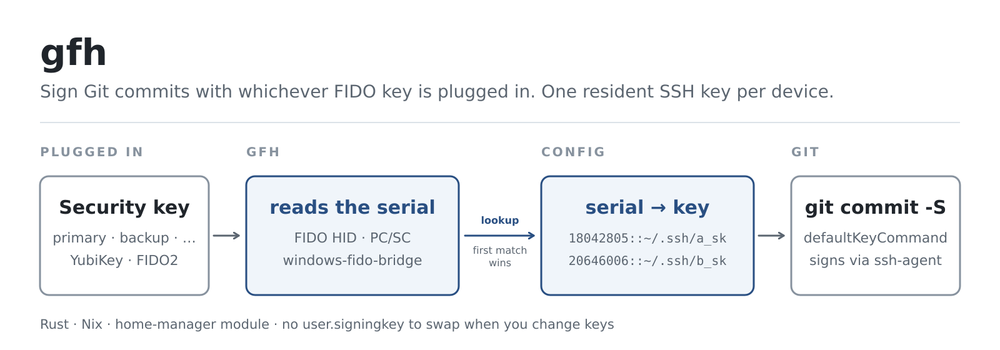

<div align="center">

# gfh

### Git FIDO helper: sign commits with whichever FIDO key is plugged in.

**One resident SSH key per security key. gfh tells git which one to use, so there is no `user.signingkey` to swap.**

[](https://github.com/aldoborrero/gfh/actions)
[](Cargo.toml)
[](#nix)
[](LICENSE)

[Quick start](#quick-start) · [How it works](#how-it-works) · [Commands](#commands) · [WSL](#wsl-windows-fido-bridge) · [Installation](#installation) · [Troubleshooting](#troubleshooting) · [Contributing](#contributing)

<br />



</div>

## Why

Git takes a single `user.signingkey`. If you keep a resident SSH key on each of two or three YubiKeys (a primary and a backup, say), whichever one you plug in has to be the one Git signs with, so you end up editing your config every time you switch keys.

gfh removes that step. Git calls it as `gpg.ssh.defaultKeyCommand`, gfh reads the serial of the key that is plugged in, looks that serial up in a small mapping file, and prints the matching public key. If you only own one key, set `user.signingkey` and you don't need gfh.

> [!NOTE]
> This is a fork of [Ovyerus/gfh](https://github.com/Ovyerus/gfh). Reading YubiKey serials over FIDO HID, the windows-fido-bridge support, the home-manager module and the Nix packaging only exist here.

## Quick start

Install gfh. With Nix it's one command; see [Installation](#installation) for home-manager and building from source.

```sh
nix profile install github:aldoborrero/gfh
```

You need a resident SSH key on each FIDO device. If you don't have one yet:

```sh
ssh-keygen -t ed25519-sk -O resident -f ~/.ssh/id_ed25519_sk_primary
```

Plug in each key in turn and map it to its SSH key:

```sh
gfh add      # pick the device (auto-selected if only one), then give the key path
gfh list     # check the mappings
```

Point Git at gfh:

```sh
git config --global gpg.format ssh
git config --global gpg.ssh.defaultKeyCommand gfh
git config --global commit.gpgsign true
git config --global tag.gpgsign true
```

Leave `user.signingkey` unset, otherwise Git uses it and never asks gfh. Your next commit asks for a touch on whichever key is plugged in.

## How it works

1. Git needs a signing key and runs `gfh` with no arguments.
2. gfh lists the connected FIDO devices and reads each one's serial. A YubiKey 5 answers Yubico's `READ_CONFIG` command over its FIDO HID interface (as it does for `ykman`), so gfh needs neither pcscd nor the CCID interface. Older YubiKeys such as the YubiKey 4 don't implement that command, and gfh falls back to PC/SC for them. Other FIDO2 devices report their serial in the HID descriptor. Under WSL, gfh asks [windows-fido-bridge](#wsl-windows-fido-bridge) instead.
3. The first connected device whose serial appears in `~/.config/gfh/keys` wins.
4. gfh reads the matching `.pub` file and prints `key::<public key>`.
5. Git signs with `ssh-keygen -Y sign -U`, which looks up the private key in your ssh-agent.

If the key isn't in the agent yet, gfh runs `ssh-add` on the configured file first. Loading a FIDO key handle needs no PIN and no touch; only the signature does. gfh runs `ssh-add` without a prompt, so a passphrase-protected key file fails fast instead of hanging your commit on an askpass dialog.

A resident credential without a local key file can't be loaded that way. gfh prints a warning and Git reports the failure; run `ssh-add -K` to pull the key off the device.

## Commands

| Command | What it does |
|---|---|
| `gfh` | Print the signing key for the connected device. This is what Git runs. |
| `gfh add` | Pick a connected device and map its serial to an SSH key file. Running it again for the same serial replaces the mapping. |
| `gfh list` | Show every mapping, whether its device is connected, and whether its key file exists. |
| `gfh remove` | Pick a mapping and delete it. |

Global options:

| Option | Env var | Default | |
|---|---|---|---|
| `-f, --file <PATH>` | | `~/.config/gfh/keys` | Mapping file to use. |
| `--hid-timeout-ms <MS>` | `GFH_HID_TIMEOUT_MS` | `2000` | How long to wait for a YubiKey to answer over FIDO HID, from 1 to 60000. A healthy key answers in a few milliseconds. |

Other environment variables:

| Variable | |
|---|---|
| `GFH_AGENT_SOCK` | Agent socket gfh loads keys into. Set it when `SSH_AUTH_SOCK` points at a read-only agent multiplexer that forwards signatures but refuses new keys. |
| `GFH_BRIDGE=0` | Ignore windows-fido-bridge and look for local devices. |

## Config file

`~/.config/gfh/keys` holds one `serial::path` per line. The path can be the private or the `.pub` key file:

```text
# Primary YubiKey
18042805::~/.ssh/id_ed25519_sk_primary
# Backup YubiKey
20646006::~/.ssh/id_ed25519_sk_backup.pub
```

`gfh add` and `gfh remove` keep comments and blank lines. Spaces around `::` are fine, so you can paste a line from `gfh list` back in. If a serial appears twice, gfh warns and uses the first line.

If the file is generated (home-manager, chezmoi, a dotfiles repo) and lives on a read-only path, `gfh add` refuses to write it and tells you to edit the source instead.

## WSL (windows-fido-bridge)

With [windows-fido-bridge](https://github.com/aldoborrero/windows-fido-bridge), your YubiKeys stay attached to Windows, so gfh can't see them over HID or PC/SC from WSL. When `SSH_SK_PROVIDER` points at the bridge's `libwindowsfidobridge.so` and `windowsfidobridge.exe` sits in the same directory, gfh runs `windowsfidobridge.exe --list-serials` and skips local devices entirely. This applies to `gfh`, `gfh list` and `gfh add`.

gfh kills the call after 10 seconds. If the bridge fails, gfh reports that failure directly, so you see the real cause rather than "no matching FIDO key found".

Loading the key works as usual: `ssh-add` reads `SSH_SK_PROVIDER` and hands it to the agent along with the key. ssh-agent only accepts providers that match its `-P` allow-list (`/usr/lib*/*,/usr/local/lib*/*` by default), so if the bridge comes from Nix, start the agent with something like `-P '/nix/store/*'`.

## Installation

### Nix

```sh
nix run github:aldoborrero/gfh -- list
```

Or add the flake as an input and use `gfh.packages.${system}.default`.

### home-manager

The flake ships a home-manager module that writes the mapping file, configures Git to sign through gfh, and generates `~/.ssh/allowed_signers` from your public keys so `git log --show-signature` can verify them:

```nix
{ inputs, pkgs, ... }:
{
  imports = [ inputs.gfh.homeModules.gfh ];

  programs.gfh = {
    enable = true;
    package = inputs.gfh.packages.${pkgs.stdenv.hostPlatform.system}.default;

    devices = {
      "18042805" = { name = "Primary YubiKey"; signingKey = "~/.ssh/id_ed25519_sk_primary"; };
      "20646006" = { name = "Backup YubiKey";  signingKey = "~/.ssh/id_ed25519_sk_backup"; };
    };

    git = {
      userName = "Your Name";        # optional, sets user.name
      userEmail = "you@example.com"; # sets user.email and the allowed_signers principal
    };

    # agentSocket = "\${XDG_RUNTIME_DIR}/ssh-agent"; # sets GFH_AGENT_SOCK
    # hidTimeout = 500;                             # sets GFH_HID_TIMEOUT_MS
  };
}
```

`git.signCommits` (on by default) turns on `commit.gpgSign` and `tag.gpgSign`. Set it to `false` if you only want gfh wired in as the signing backend.

### From source

```sh
cargo build --release   # binary at ./target/release/gfh
```

On Linux you'll need `pkg-config`, the PC/SC lite headers and libudev (`pkg-config libpcsclite-dev libudev-dev` on Debian/Ubuntu).

### Upstream packages

`cargo install gfh` and `brew install ovyerus/tap/gfh` build the original Ovyerus/gfh, not this fork.

## Troubleshooting

**`no matching FIDO key found in the config`.** Run `gfh list`. If every mapping says `not connected`, gfh didn't find the key you plugged in. An older YubiKey is only visible over PC/SC, so check that pcscd is running and the CCID interface is enabled; gfh prints a warning when it can't reach PC/SC.

**`could not load the signing key into the ssh-agent`.** gfh shows the `ssh-add` command it ran and what `ssh-add` said. If `SSH_AUTH_SOCK` is a read-only multiplexer, set `GFH_AGENT_SOCK` to the writable agent behind it, e.g. `$XDG_RUNTIME_DIR/ssh-agent`.

**`... the agent git uses (SSH_AUTH_SOCK) does not expose it`.** gfh loaded the key into the agent at `GFH_AGENT_SOCK`, but Git asks the agent behind `SSH_AUTH_SOCK`, which doesn't see it. Point `GFH_AGENT_SOCK` at an agent that `SSH_AUTH_SOCK` reaches.

**`signing key is not in the ssh-agent and ... does not exist`.** The mapping points at a resident credential with no key file on disk. Load it with `ssh-add -K`, or export it with `ssh-keygen -K` and map the resulting file.

**A commit hangs before the touch prompt.** A YubiKey that never answers over HID delays the commit by up to `GFH_HID_TIMEOUT_MS`. Under WSL, a cold start of the bridge's Windows process can take a second or more.

## Compatibility

Tested with the YubiKey 5C NFC. Any FIDO2 device that reports a serial in its HID descriptor should work. If you try another device, please open an issue saying whether it worked, so the list can grow.

## Contributing

Issues and pull requests are welcome at [aldoborrero/gfh](https://github.com/aldoborrero/gfh). CI runs `nix flake check` and builds for Linux and macOS, so run it locally before you open a PR.

```sh
nix develop          # Rust toolchain, clippy, rust-analyzer, pcsclite
cargo test
nix flake check      # clippy (deny warnings), rustfmt, build
nix fmt              # treefmt: rustfmt, nixfmt, deadnix, taplo
```

## Acknowledgments

gfh was created by [Ovyerus](https://github.com/Ovyerus) at [Ovyerus/gfh](https://github.com/Ovyerus/gfh) ("Git FIDO helper, or God Fucking Help me"). The idea, the `serial::path` config format and the `defaultKeyCommand` approach all come from there, and this fork builds on that work.

## License

MIT, see [LICENSE](LICENSE). Copyright 2022 Ovyerus.
